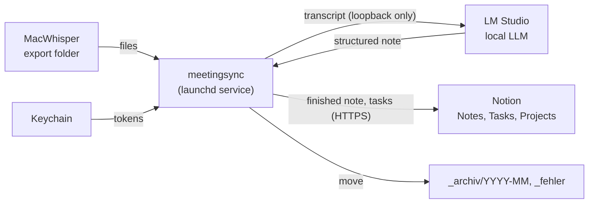
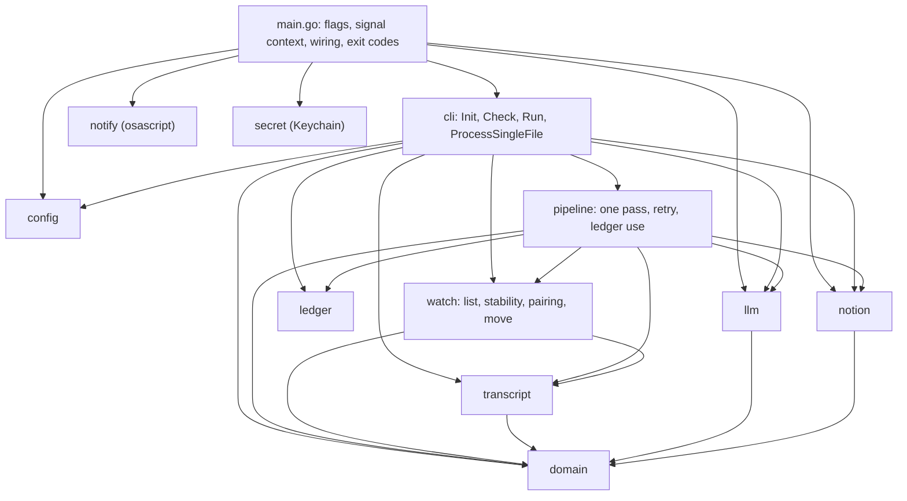
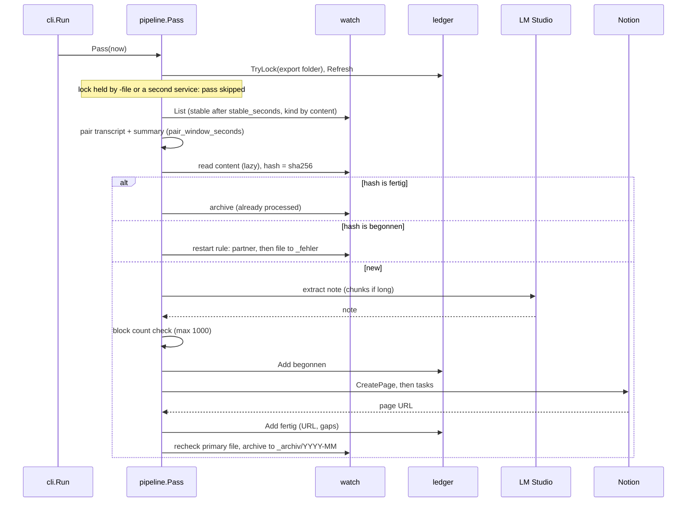
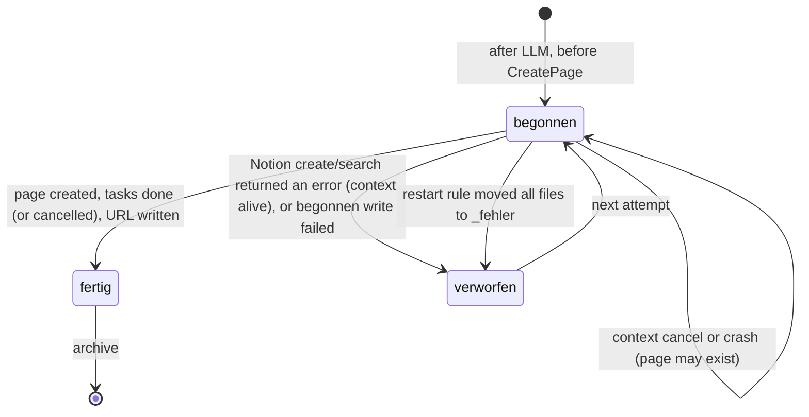
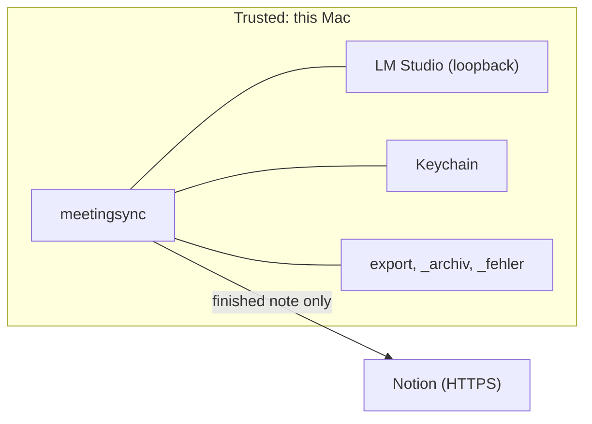

# Architecture

Current state only. Decisions and their reasons are in the ADRs (`docs/adr/`), linked below.

## Context

meetingsync is one Go process on the Mac. It turns MacWhisper exports into meeting notes in Notion.

Entry points (`main.go`): normal run (poll loop), `-once`, `-file <file>`, `-dry-run`, `-check`. Options and config: `README.md`, `config.example.yaml`.

## Packages and dependency direction

Arrows are imports (checked against `go list`). All of `internal/*` is import-protected by Go; the rules below are enforced by `arch_test.go` (ADR [0015](adr/0015-package-split.md)).

| Package | Job | Allowed imports (arch_test.go) |
| --- | --- | --- |
| `domain` | note types, `Transient` error class, `RedactURL` | stdlib |
| `transcript` | detect transcript or summary, parse | stdlib, `domain` |
| `ledger` | JSONL ledger, folder lock (`flock`) | stdlib |
| `llm` | LM Studio client, chunking | stdlib, `domain` |
| `notion` | Notion client, blocks, properties | stdlib, `domain` |
| `watch` | folder listing, stable check, pairing, atomic move | stdlib, `x/sys/unix`, `domain`, `transcript` |
| `pipeline` | one pass over the export folder, retry policy | stdlib, `x/sys/unix`, `domain`, `transcript`, `ledger`, `watch`, `llm`, `notion` |
| `cli` | entry points, dry-run output | as `pipeline`, plus `config`, `pipeline`, `go.yaml.in/yaml/v3` |
| `config` | YAML/JSON config, defaults, validation | stdlib, `go.yaml.in/yaml/v3` |
| `notify`, `secret` | `osascript`, `security` (Keychain) | stdlib |

- No package below `cli` may import `pipeline` or `cli`. The `Notifier` interface (declared in `pipeline`) keeps `pipeline` free of `notify` and `os/exec`. The `Notion` interface is for dependency injection (ADR [0006](adr/0006-interfaces-and-dependency-injection.md)).
- `arch_test.go` enforces that `os/exec` is not imported in `internal/*` outside `notify` and `secret`. `main.go` builds token and notifier and hands them to `cli` in `cli.Env`.
- `watch.FS` is the read side only (`ReadDir`, `ReadFile`, `Lstat`). The move is `watch.Mover` with `RENAME_EXCL` (ADR [0005](adr/0005-golang-x-sys-for-atomic-rename.md), 0015).

## One pass

`cli.Run` calls `Pipeline.Pass` immediately and then every `poll_interval_seconds` (default 10).

- A summary without a transcript: `HasNear` match archives it; otherwise after `orphan_summary_minutes` the `orphan_summary_action` applies (`note`, `archive`, `keep`).
- Dry-run takes no lock, writes no ledger, moves nothing. `-file` takes the lock, writes the same ledger lines, does not move (ADR [0013](adr/0013-file-ledger-and-folder-lock.md)).

## Ledger states

`.meetingsync-ledger.jsonl` in the archive folder, append-only, last line per hash wins. Only `fertig` counts as processed (ADR [0004](adr/0004-ledger-states-and-crash-behavior.md)).

- Crash or cancel in `begonnen`: next pass moves partner first, then transcript to `_fehler` with a hint to check Notion. Moving the file back runs it again.
- Ambiguous `CreatePage` failure (5xx, network error incl. timeout, unreadable/invalid 2xx body): `verworfen`, but before the next create Notion is queried for the source marker (needs `notes_properties.source`). Details in ADR 0004.
- Lines without status (from `v1.0.0`) count as `fertig`.

## Errors and retry

All errors count together against `max_attempts` (default 10). Only the wait differs (`internal/pipeline/retry.go`).

| Error class | Examples | Wait before next try |
| --- | --- | --- |
| Transient (`domain.IsTransient`) | LM Studio or Notion unreachable (incl. timeout), HTTP 429/5xx, model not loaded, Notion 401/403/404 | 1, 2, 4, 8, 16 min, then every 16 min |
| Other | bad LLM output, other Notion 4xx (e.g. 400 validation), ledger not writable | 2 min |
| Cancelled context (Ctrl+C, launchd stop) | transient error while shutting down | not counted |
| Archive or restart-rule move failed | `Move` error | 2 min, not counted, never `_fehler` |

- At `max_attempts` the files go to `_fehler` with `.fehler.txt`. If that move fails, the next try (2 min) goes straight to `_fehler` without an LLM run.
- A note with more than 1000 Notion blocks (transcript not counted) is not retried and goes to `_fehler` at once (`notion.MaxBloecke`, checked in `prepare` after the LLM, before `begonnen` and before any Notion write).
- After the page exists, missing tasks or blocks are only logged and recorded in the `fertig` line, never retried.

## Security model

| Rule | Where | ADR |
| --- | --- | --- |
| Raw transcript never leaves the Mac; Notion gets it only with `include_transcript` | `pipeline`, `llm` | - |
| `llm.base_url` must be loopback; no proxy, no redirects | `config`, `llm` | [0007](adr/0007-llm-base-url-loopback-only.md) |
| `notion.base_url` must be `https` (`http` only for loopback test fakes); no redirects; unlike the LLM client, the proxy from the environment (`HTTP(S)_PROXY`) is used | `config`, `notion` | [0008](adr/0008-notion-https-only.md) |
| Notion token: `NOTION_TOKEN` env, then Keychain (`meetingsync-notion`, only if `token_keychain_service` is set; an error aborts; in `-dry-run` it is logged and the run goes on without Notion), then `notion.token` | `secret` | - |
| LLM key: `LLM_API_KEY` env, then Keychain (if `api_key_keychain_service` is set), then `llm.api_key`; empty = no header | `secret` | [0014](adr/0014-llm-api-key-keychain.md) |
| `os/exec` only in `notify` (`/usr/bin/osascript`) and `secret` (`/usr/bin/security`), fixed path constants, no shell | `notify`, `secret` (import rule for `internal/*` in `arch_test.go`; paths not tested) | - |
| Nothing existing is deleted without Mark's approval (notes, relations, archive, failed files) | project constraint | `CLAUDE.md` |
| Real config is in `~/.config/meetingsync/` (default; `-config` can point elsewhere). Token: `NOTION_TOKEN`, then Keychain, only last `notion.token` in the config file. Never in the repo | - | - |

LM Studio being trustworthy is an assumption: meetingsync only enforces a loopback `base_url`, not what LM Studio does with the data.

## Deployment

launchd user agent `de.borukhov.meetingsync` (`RunAtLoad`, `KeepAlive`) runs `~/bin/meetingsync -config ~/.config/meetingsync/config.yaml`; the log goes to `~/Library/Logs/meetingsync.log`. A user agent is needed for Keychain and notifications. Install, update and commands: [launchd.md](launchd.md). Restart the service after installing a new binary (ADR 0013).

## Related

- ADRs: [0004](adr/0004-ledger-states-and-crash-behavior.md), [0005](adr/0005-golang-x-sys-for-atomic-rename.md), [0006](adr/0006-interfaces-and-dependency-injection.md), [0007](adr/0007-llm-base-url-loopback-only.md), [0008](adr/0008-notion-https-only.md), [0013](adr/0013-file-ledger-and-folder-lock.md), [0014](adr/0014-llm-api-key-keychain.md), [0015](adr/0015-package-split.md)
- Review that led to this layout: [architecture and security review](reviews/2026-11-01-architektur-und-security-review.md)
