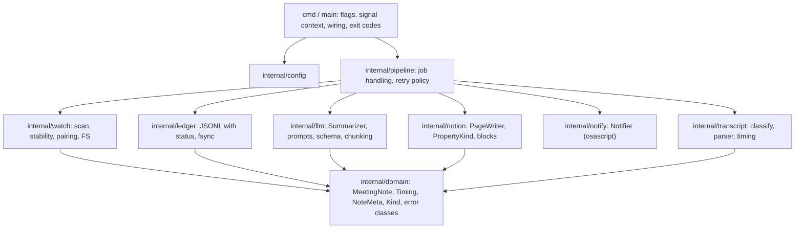

# Architecture and security review of meetingsync

Date: 2026-11-01. Base: `v1.0.0` + `6ab0703` (`main`). Two reviews: architecture/code and security. Work plan: [refactoring plan](../superpowers/plans/2026-11-01-refactoring.md).

## 1. Summary and verdict

- Good on the functional side: pairing, ledger by content hash, backoff, Notion limits and privacy rules work. Some of them are tested.
- Not maintainable in structure: everything is in `package main`, `App` is a god object, there are no seams. Tests only work through one combined fake server.
- Two critical correctness gaps in error paths (A-01, A-02): duplicate pages or missing tasks in Notion are possible.
- Security: one high finding (S-01, 26 reachable stdlib CVEs because of an old toolchain). The rest are medium or low hardening points. No secrets in the git history.
- Verdict: running the tool is fine once the toolchain is updated. Before more feature work: first a safety net (golden tests), then the error paths, then the package split.

| Measure | Result |
| --- | --- |
| `go vet` | ok |
| `go test -race` | ok |
| Total coverage | 69.2 % |
| 0 % coverage | `Run`, `Check`, `ProcessSingleFile`, `notify`, `LLM.Models`, Notion `backoff`/`retryAfter`/`sleepCtx` |
| Partial coverage | `LoadLedger` 26.7 %, `Notion.do` 58.8 % |
| golangci-lint | 12 findings (8 errcheck, 4 staticcheck) |
| govulncheck | 26 reachable stdlib vulnerabilities (go1.25.5; fixed from go1.26.10), none in the yaml module |
| `go mod verify` | ok |
| GitHub | Public repo, Dependabot alerts off, no branch protection, tag and commits unsigned |

## 2. Strengths

- Pairing and orphan logic with a stability window, content-hash ledger, backoff with a cap.
- The Notion client separates idempotent from non-idempotent requests. Non-idempotent creates are not retried automatically.
- Notion limits (100 blocks, 2000 characters) are wrapped in one place and tested. Splits are UTF-8 safe.
- Structured output with fallback; schema enums; deadline validation; Notion text without links or mentions.
- Token: lookup order without a shell, never in the log; `Authorization` is dropped on a cross-host redirect; no `InsecureSkipVerify`.
- YAML errors without file content (ADR 0001); no path traversal; dotfiles and temp files ignored; 20 MB limit.
- Timeouts and limited retries; race-free; `.gitignore` ok; `go.sum` verified; German code comments.

## 3. Findings by severity

Severity: K = critical, H = high, M = medium, N = low. Evidence refers to `6ab0703`.

| ID | Severity | Area | Finding | Evidence | Fix direction |
| --- | --- | --- | --- | --- | --- |
| A-01 | K | Correctness | No crash safety: `CreatePage` → `createTasks` → `ledger.Add` → `archive`. A crash in between creates a duplicate page. A Notion 5xx on `POST /v1/pages` counts as transient and is retried, including a new LLM run, although the page may exist | app.go:278-283, notion.go:92-93, notion.go:226 | Ledger status "begonnen" (started) before `CreatePage` (D1) |
| A-02 | K | Correctness | `createTasks` swallows every error, including `context.Canceled`. A note without tasks gets archived | app.go:455-458 | Pass context cancellation on, record what is missing |
| S-01 | H | Supply chain | `go.mod` has no `toolchain`. Build with go1.25.5 gives 26 CVEs (crypto/tls, x509, net/http, net/url, os), all reachable | go.mod:3; llm.go:183, llm.go:231, notion.go:68, app.go:675 | `toolchain go1.26.10`, govulncheck in CI |
| A-03 | H | Structure | Everything in `package main` | all `*.go` | Package split (section 4) |
| A-04 | H | Structure | `App` is a god object: scan, pairing, retry, LLM orchestration, Notion mapping, archive, ledger, notify, CLI output | app.go:22-39; 522, 579, 291, 321, 405, 424, 609, 687, 756, 141, 508 | Split into `pipeline`, `watch`, `ledger`, `notion`, `notify` |
| A-05 | H | Testability | No seams: concrete pointers for LLM/Notion, direct `os.*`, `time.Now()` in the flow, `osascript` without abstraction. Tests need one combined fake server, retry tests bypass the constructor | app.go:26-27; 523, 551, 662; 280, 350, 476, 635; e2e_test.go:20-129; app_retry_test.go:26 | Interfaces Clock, FS, Summarizer, PageWriter, Notifier |
| A-06 | H | Structure | Domain and infrastructure are mixed. `transient()`/`isTransient` live in the Notion client and are used by LLM and App | llm.go:20, classify.go:248, notion.go:144, blocks.go:11, app.go:695, notion.go:254-266, llm.go:185, app.go:293 | `internal/domain` with types and error classes |
| A-07 | H | Structure | Notion property JSON is built in `app.go`; 28 string-literal comparisons of property types | app.go:113-129, 405-462; notion.go:152-155 | Typed `PropertyKind` mapping in `internal/notion` |
| A-08 | H | Tests | Gaps: ledger reload, Notion retry/backoff/Retry-After, chunking (`chunkSystemPrompt` 0 %), orphan archive/keep, `near` wait window, pass gating `nextTry`, LLM parse retry, `finish_reason=length` | app.go:229; llm.go:279 | Unit and golden tests |
| A-09 | H | Tooling | No CI, no lint in the Makefile, no `build` target, no version in the binary | Makefile, go.mod | Makefile targets, GitHub Actions |
| S-02 | M | Privacy | `llm.base_url` can be set freely. The transcript (PII) can go to a foreign host over plain HTTP | config.go:109, llm.go:175-185 | Loopback only (D3) |
| S-03 | M | Secrets | `notion.base_url` has no scheme check. The token can go out in clear text. A URL with `user:pass@` would be logged | config.go:116, notion.go:59-63, llm.go:185 | HTTPS required (loopback for tests), reject userinfo |
| S-04 | M | Files | Symlinks in the watch folder are followed: `d.Info()` is Lstat, `ReadFile` follows. Any file (for example the config with the token) can reach the LLM/Notion. The 20 MB limit is bypassed | app.go:531-551 | Skip symlinks |
| S-05 | M | Repo | Real Notion data source IDs are public | config.example.yaml:124-128, config.example.json:24-26, README.md:76 | Placeholders + clean the history (D2) |
| S-06 | M | Prompt injection | Meeting participants can steer tasks (`fuer_mich`), decisions and project. Limited by enum/match, deadline validation, plain text | llm.go:259-276; app.go:392-401, 424-461 | `Prüfen` flag for to-dos for Mark (D5) |
| S-07 | M | Supply chain | No CI, no Dependabot, no branch protection, no `SECURITY.md`, unsigned tags | GitHub settings | CI, Dependabot, `SECURITY.md`; settings by Mark |
| A-10 | M | Performance | Every stable file is read fully in every 10 s pass, also during backoff | app.go:551 | Read content only when processing |
| A-11 | M | Correctness | Errors when writing the ledger, `.fehler.txt` and remaining blocks are ignored. Ledger has no fsync | app.go:280, app.go:635, notion.go:230-233 | Handle errors, fsync (see S-13) |
| A-12 | M | Config | Silent clamps; `timeout_minutes` 0 gives an HTTP client without timeout; unknown keys silently ignored; `Config.loc` is runtime state; `NotionToken()` starts a subprocess from the config layer | config.go:217-225, llm.go:73, config.go:236, config.go:247 | Validation with warnings, TokenSource interface |
| A-13 | M | Logging | No levels, emoji as structure, `Check()` mixes `fmt.Printf` and the logger | app.go:142-173 | Keep texts stable; slog only after its own decision |
| A-14 | M | CLI | `-check` exits 0 despite ✗; `-file` writes no ledger entry | app.go:164, app.go:480-506 | Decided: R-M3-13, R-M3-14 (D7, D8) |
| A-15 | M | HTTP | Two parallel HTTP error types; `Models()` has no status code check and uses the 30 min timeout | llm.go:83-90, 175-199; notion.go:37-45, 59-99; llm.go:223-249 | One type per package, shared error class in `domain`; own timeout |
| A-16 | M | Tests | Flake: archive month comes from `time.Now()` in the test but from `ModTime` in the code; `go build` in the acceptance test is not hermetic | e2e_test.go:290 vs. app.go:614; config_yaml_acceptance_test.go:159 | Month from `ModTime`; re-exec of the test binary |
| S-08 | N | Network | `io.ReadAll`/`Decode` without an upper limit; `Models()` without status code | llm.go:188, notion.go:75, llm.go:241 | `io.LimitReader`, check status code |
| S-09 | N | Notion | Number of blocks from LLM lists is unlimited | blocks.go:19-103, notion.go:229-249 | Total cap |
| S-10 | N | Processes | `security`/`osascript` are started via PATH with the full environment (escaping is correct) | config.go:247, app.go:761 | `/usr/bin/...`, minimal environment |
| S-11 | N | Privacy | Meeting titles in Mac notifications | app.go:400, app.go:760 | Stays (D6) |
| S-12 | N | Files/log | Log has titles, task texts, URLs; launchd log has no rotation; ledger and `.fehler.txt` are 0644, folders 0755 | app.go:357, 390, 456, 635, 649, 741, 744; de.borukhov.meetingsync.plist:28-31 | 0600/0700; log rotation rejected (D10) |
| S-13 | N | Ledger | Errors from `ledger.Add` are dropped | app.go:280 | Same as A-11 |
| S-14 | N | Files | `moveFile`: stat/rename race, silent overwrite possible, copy path without sync | app.go:656-682 | Exclusive create (link or `O_EXCL`), sync |
| S-15 | N | Files | TOCTOU between read/hash and move | app.go:545-551, app.go:271 | Re-stat before archiving |
| S-16 | N | Notion | Config ID is not escaped in the URL path | notion.go:110-120, notion.go:176 | `url.PathEscape` |
| S-17 | N | Config | `%q` with config values in error messages | config.go:210, config.go:234 | Leave values out (progress #1) |
| S-18 | N | Secrets | `llm.api_key` only in clear text | config.go (LLMConfig) | Keychain (D9, R-M3-15) |
| S-19 | N | Network | `timeout_minutes` ≤ 0 means no timeout | llm.go:73 | Same as A-12 |
| S-20 | N | Repo | Prompt names "Head of Engineering" and "Sascha" | llm.go:259, llm.go:264 | Configurable (D4) |
| S-21 | N | Operations | plist `KeepAlive` without `ThrottleInterval` gives a restart loop on a config error; binary in `~/bin` is unsigned | de.borukhov.meetingsync.plist:23-24 | `ThrottleInterval` (60 s) |
| A-17 | N | Readability | Magic numbers | app.go:547, 468, 316, 310; notion.go:158, 167; llm.go:127, 89, 197, 408; classify.go:106, 111 | Named constants, values unchanged |
| A-18 | N | Readability | `map[bool]string{}[cond]`, abbreviations, `job.summaryOnly` duplicates `primary.Kind`, `contains` instead of `slices.Contains`, mixed German/English field names | app.go:277, app.go:390, app.go:66, classify.go:381 | Clean up during the package split |
| A-19 | N | Robustness | Unbounded maps `warned`/`cache`; `Ledger.mtimes` is linear; state is not deleted after a ledger hit | app.go:33-35, app.go:726-733, app.go:272-276 | Clean up per pass |
| A-20 | N | Repo | Personal defaults (`MyName` "Mark"), real IDs in examples | config.go:104 | See S-05; `my_name` is in Mark's config, so the default can become neutral |
| A-21 | N | Docs | No architecture doc, bugs only in `docs/progress.md` | docs/ | `docs/architecture.md`, `docs/testing.md` |

## 4. Target architecture

| Package | Responsibility | Rule |
| --- | --- | --- |
| `cmd` (or root `main`) | Flags, signals, wiring, exit codes | Only place that reads the config |
| `internal/config` | Load, validate, defaults | No `exec`, no `loc` field; token source as an interface |
| `internal/domain` | Domain types, error classes | No imports from the project |
| `internal/transcript` | Detection, parser, meeting time | Pure functions |
| `internal/llm`, `internal/notion` | Clients behind `Summarizer` / `PageWriter` | Import only `domain` |
| `internal/watch`, `internal/ledger`, `internal/notify` | File system, persistence, notifications | Behind interfaces (FS, Notifier) |
| `internal/pipeline` | Flow and retry | Gets Clock, FS, Summarizer, PageWriter, Notifier injected |

## 5. Decisions by Mark (2026-11-01)

| ID | Decision | Findings |
| --- | --- | --- |
| D1 | Ledger entry "begonnen" (started) before `CreatePage`. After a restart, "begonnen without URL" moves the file to `_fehler` with a note to check Notion by hand. No Notion database change | A-01, A-11, S-13 |
| D2 | Notion IDs: placeholders AND clean the git history (destructive, separate approval right before it runs) | S-05, A-20 |
| D3 | `llm.base_url` only loopback (`localhost`, `127.0.0.1`, `::1`). Otherwise the start aborts with a clear message. Mark's config is already loopback (`http://localhost:1234/v1`) | S-02 |
| D4 | Prompt: role and example name are configurable. Default is neutral in the repo. Mark's config holds the values, so his result stays the same. `my_name: Mark` is already in his config | S-20, A-20 |
| D5 | Notes with to-dos for Mark (`fuer_mich`) always get the `Prüfen` flag | S-06 |
| D6 | Meeting titles in Mac notifications stay | S-11 |
| D7 | `-check` exits with a code other than 0 when a check shows ✗ (progress #5). Mandatory task R-M3-13 | A-14 |
| D8 | `-file` without `-dry-run` writes a ledger entry (progress #6). Mandatory task R-M3-14 | A-14 |
| D9 | `llm.api_key` can be read from the Keychain. Mandatory task R-M3-15 | S-18 |
| D10 | Rejected: log rotation and less log content (S-12); switch to `log/slog` (A-13) | S-12, A-13 |
| D11 | `ThrottleInterval` in the plist is 60 s | S-21 |
| D12 | All other proposals in plan section 9 are accepted (decided: proposal). Examples: keep `go 1.22`; Notion 5xx on `POST /v1/pages` stays transient until data exists; `notion.base_url` without HTTPS aborts the start | see plan |
| D13 | Language rule: all documentation is in simple, plain English. Code comments, logs and Notion content stay German | – |

## 6. Still open

| # | Question | Finding |
| --- | --- | --- |
| 1 | Value and behavior of the block total cap (plan OD-11). Asked right before R-M3-06 | S-09 |
| 2 | History rewrite: tool (`git filter-repo` needs installing) and time (plan OD-15). Asked right before R-M4-02 | S-05 |

`%q` in error messages (progress #1, S-17) is a fix with no behavior change and is planned. More detail questions are collected in the plan, section 9.
